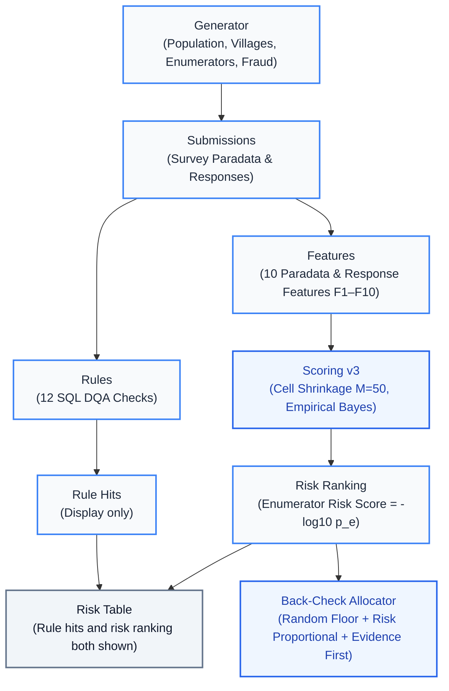

# Curbstone

Survey data collection in low- and middle-income countries frequently suffers from enumerator fabrication ("curbstoning"), where interviewers falsify responses or whole interviews rather than visiting assigned households. **Curbstone** provides a tamper-evident evaluation benchmark and an automated detection pipeline: a synthetic population data-generating process (DGP) calibrated to household survey data from rural Bangladesh with intra-cluster correlation (ICC) across assets, 5 standard fabrication mechanisms plus 1 held-out out-of-distribution mode, a 12-rule SQL Data Quality Assurance (DQA) engine, and an Empirical Bayes risk-ranking detector (Scoring v3) paired with an evidence-prioritizing back-check allocator. Explore the interactive demonstration, live in-browser SQL rule engine, and full benchmark results at [<PAGES_URL>](<PAGES_URL>).

---

## Headline Findings

All metrics reflect full evaluation across 72 factorial configurations (1,440 rounds, seeds 1000..1019) with paired bootstrap 95% confidence intervals:

- **Risk Ranking vs. Deterministic Rules:** Scoring v3 achieves a **+0.1307 [+0.1191, +0.1422]** precision@4 advantage over deterministic rule filtering, and **+0.1946 [+0.1783, +0.2110]** higher average precision across all rounds. In relative precision (precision / max achievable), v3 achieves 49.4%–80.2% across medium-to-high prevalence settings compared to rules' 25.0%–61.3%.
- **Shrinkage by Workload:**
  - *Low workload ($n \in [5, 15]$):* Cell-level shrinkage ($M = 50$) improves precision@4 by **+0.0693 [+0.0521, +0.0865]** over un-shrunk scoring.
  - *Mixed workload ($n \in [5, 60]$):* Shrinkage does not improve precision@4 (**-0.0057 [-0.0214, +0.0099]**) and shifts false flags onto small-sample honest enumerators: they take **196/1,920** top-4 slots with shrinkage vs. **66/1,920** without (**+0.0677 [+0.0552, +0.0807]**).
  - *Straight-lining trade-off:* Shrinkage reduces straight-lining detection (average precision difference: **−0.1152 [−0.1417, −0.0886]**). Scoring is permanently frozen; ranking by posterior probability of a material effect is the recommended next step.
- **Per-Mode Recall@k (Wilson 95% CIs and Counts):**
  - `copy_paste`: **950/990 (0.9596) [0.9454, 0.9702]** (v3) vs. 741/990 (0.7485) [0.7205, 0.7745] (no-shrinkage) vs. 817/990 (0.8253) [0.8004, 0.8476] (rules).
  - `straight_lining`: **411/1116 (0.3683) [0.3405, 0.3970]** (v3) vs. 630/1116 (0.5645) [0.5353, 0.5933] (no-shrinkage) vs. 85/1116 (0.0762) [0.0620, 0.0932] (rules).
  - `rushed`: **343/990 (0.3465) [0.3175, 0.3766]** (v3) vs. 359/990 (0.3626) [0.3333, 0.3931] (no-shrinkage) vs. 621/990 (0.6273) [0.5967, 0.6568] (rules).
  - `invented_gps`: **561/1026 (0.5468) [0.5162, 0.5770]** (v3) vs. 498/1026 (0.4854) [0.4549, 0.5160] (no-shrinkage) vs. 72/1026 (0.0702) [0.0561, 0.0875] (rules).
  - `too_average`: **131/1278 (0.1025) [0.0870, 0.1203]** (v3) vs. 60/1278 (0.0469) [0.0366, 0.0600] (no-shrinkage) vs. 48/1278 (0.0376) [0.0284, 0.0494] (rules).
- **Held-Out Mode (`partial_section`) with Caveat:** Scoring v3 achieves **11/15 (0.7333) [0.4805, 0.8910]** recall on out-of-distribution fabricators (seeds 2000..2019) vs. 7/15 (0.4667) for no-shrinkage and 1/15 (0.0667) for rules. *Caveat:* Evaluated on $n = 15$ fabricators; detection was driven overwhelmingly by Feature F8 (age heaping in 10 of 11 detections), matching the holdout mechanism where only the household roster was fabricated.
- **Detection Rate over Time (Prevalence 0.10, $k = 4$):** `copy_paste` is flagged immediately at Day 2 (18/18 [0.824, 1.000]); `straight_lining` flags 12/16 [0.505, 0.898] at Day 2 and 11/16 [0.444, 0.858] by Day 10; `invented_gps` accumulates from 7/15 [0.248, 0.699] at Day 2 to 12/15 [0.548, 0.930] by Day 10; `rushed` detects 3/15 [0.070, 0.452] throughout; `too_average` detects 1/16 [0.011, 0.283].

---

## What Did Not Work

- **Calibrated False Discovery Rate (FDR):** Scoring v1 failed acceptance on null calibration rounds under the pre-registered stopping rule. Scoring v2 adjusted degrees of freedom and count variance, but rare-event cell counts still broke calibration. Scoring v3 introduced cell shrinkage ($M = 50$) and permanently froze the scoring engine, evaluated strictly on fresh held-out seeds (300..319 null, 400..419 fraud, 1000..1019 robustness).
- **Feature F10 (Start-Time Clustering):** Produced zero predictive signal across all configurations because fieldwork logistics naturally distribute start times cleanly across daylight hours.
- **`too_average` Detection:** Barely detected (10.25% recall) because village-level intra-cluster correlation (ICC) naturally reduces between-household variance, masking synthetic typicality.
- **`rushed` Detection:** Simple deterministic rules caught rushed interviews significantly better (62.73% recall) than statistical scoring (34.65% recall) via absolute minimum duration thresholds, as honest enumerators exhibit high natural variance in interview pacing.

---

## Engineering Notes

- **Cross-Engine SQL Parity:** Browser parity testing between native Python DuckDB and DuckDB-Wasm identified an offset-parsing discrepancy on `+06:00` ISO timestamps (DuckDB-Wasm converted to UTC while native DuckDB parsed wall-clock time), leading to 736 vs. 0 hits on rule R07. Fixed via canonical offset-free substring timestamp parsing in [rules/submissions_view.sql](rules/submissions_view.sql).
- **Browser Cache / Range-Read Corruption:** DuckDB-Wasm's internal Thrift Parquet reader issued HTTP Range requests. When browser HTTP caches stored partial responses, repeat page loads served zero-filled headers, triggering `TProtocolException: Invalid data`. Fixed by loading Parquet files with `FileAttachment.parquet()` via `parquet-wasm` and passing in-memory Apache Arrow tables directly to DuckDBClient (`insertArrowTable`).

---

## Data Lineage Architecture



- **In-Browser Rule Engine Scale Benchmark:** 1M rows, all 12 rules: median 1,712 ms over 3 runs (1,760 / 1,712 / 1,677 ms); single-threaded DuckDB-Wasm; Windows, 16 logical CPUs, Chromium 152; parity with the Python engine 12/12 rules in both scenarios.

---

## Limitations & External Validity

- **Theoretical & DGP Limitations:** See [docs/dgp.md §8](docs/dgp.md#8-limitations-and-simplifications) for assumptions regarding timestamp distributions, spatial clustering, and linear asset correlation models.
- **External-Validity Caveat:** Simulated fraud patterns represent mathematically parameterized behaviors (e.g., fixed edit rates, anchor-point clustering). Real-world fabricators may exhibit adaptive, subtle, or unstructured behaviors that are harder to detect than the parameterized mechanisms evaluated here.

---

## Reproducibility

```bash
# 1. Install Python dependencies
pip install -r requirements.txt

# 2. Run the test suite
pytest

# 3. Generate demo scenarios and build outputs
python scripts/build_demo.py all

# 4. Install site dependencies, test checks, and build Observable Framework site
cd site
npm ci
npm test
npm run build

# 5. Start the local preview server
npm run dev
```
