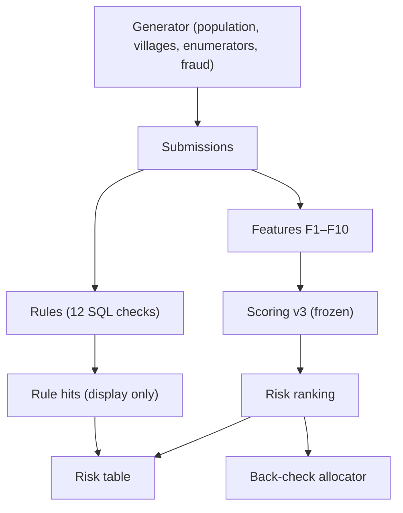

# Curbstone

**Detecting likely fabricated survey interviews ("curbstoning") at the enumerator level, using synthetic data with known ground truth.**

Range and skip checks pass fabricated interviews, because a careful fabricator enters plausible values. Curbstone compares each enumerator's behaviour (interview duration, daily throughput, near-duplicate answers, answer dispersion, GPS spread, age heaping, non-response) with peers working in the same villages, ranks enumerators by risk, and allocates a fixed back-check budget with a random floor so that unflagged staff are still audited. A fabrication simulator with five fraud modes (plus one mode held out from development) makes detection performance measurable instead of asserted.

**All data in this repository is synthetic.** Household-size and asset-ownership marginals are set to published Bangladesh figures (HIES 2022; BBS ICT Use and Access Survey 2022, taken from secondary reports and flagged for verification in `docs/dgp.md`). Paradata parameters (durations, timing, GPS error) are assumptions.

Live demo, in-browser rule engine and full results: https://tahmidshafi.github.io/curbstone/

---

## Headline results

Robustness study: 72 configurations × 20 rounds (seeds 1000–1019), scoring engine frozen before evaluation. Intervals are paired bootstrap 95% CIs unless marked Wilson.

- **Risk ranking beats rule checks.** Precision@4 +0.131 [+0.119, +0.142] and average precision +0.195 [+0.178, +0.211] over a baseline that ranks enumerators by the number of distinct rules they trigger.
- **The effect of shrinkage depends on workload.**
  - Low workload (5–15 interviews each): precision@4 +0.069 [+0.052, +0.087].
  - Mixed workload (5–60): no change in precision@4 (−0.006 [−0.021, +0.010]), but false flags shift onto small-sample honest enumerators. They take 196/1,920 top-4 slots with shrinkage vs 66/1,920 without (+0.068 [+0.055, +0.081]).
  - Shrinkage also lowers straight-lining detection (average precision −0.115 [−0.142, −0.089]).
  - The ablation switches off empirical-Bayes overdispersion and between-enumerator variance; peer-rate smoothing (M = 50) is used in both variants.
- **Recall@4 by fraud mode** (Wilson 95% CIs; v3 / no shrinkage / rules):

  | Mode | Scoring v3 | No shrinkage | Rules |
  |---|---|---|---|
  | copy_paste | 950/990 (0.96) [0.95, 0.97] | 741/990 (0.75) | 817/990 (0.83) |
  | invented_gps | 561/1026 (0.55) [0.52, 0.58] | 498/1026 (0.49) | 72/1026 (0.07) |
  | straight_lining | 411/1116 (0.37) [0.34, 0.40] | 630/1116 (0.56) | 85/1116 (0.08) |
  | rushed | 343/990 (0.35) [0.32, 0.38] | 359/990 (0.36) | **621/990 (0.63)** |
  | too_average | 131/1278 (0.10) [0.09, 0.12] | 60/1278 (0.05) | 48/1278 (0.04) |

- **Held-out mode (`partial_section`, only the age roster fabricated):** 11/15 detected (0.73, Wilson [0.48, 0.89]) vs 1/15 for rules. F8 (age heaping) supplied the evidence in 10 of the 11 detections. Caveat: the mode was unseen during development but not adversarial. Its mechanism (heavy heaping) was chosen knowing that a generic age-heaping feature existed.
- **Detection by working day** (prevalence 0.10, top 4; Wilson CIs):
  - copy_paste: 18/18 by day 2.
  - invented_gps: 7/15 on day 2, rising to 12/15 by day 6.
  - straight_lining: about 11/16 throughout.
  - rushed: 3–5/15.
  - too_average: 1/16.

## What did not work

- **Calibrated false-discovery-rate (FDR) control was not achieved.**
  - Scoring v1 failed its pre-registered honest-data acceptance test.
  - Two documented amendments and a post-hoc v2 also failed.
  - v3, evaluated only on fresh seeds, still flagged at least one honest enumerator in 11 of 20 honest-only rounds.
  - The delivered method is therefore risk ranking with a fixed back-check budget, not a calibrated flagging decision. Full history: `docs/dgp.md` §10–§12.
- **F10 (correlation between household size and interview duration) has no signal for rushing by construction.** The rushing mode multiplies every duration by a constant, which leaves rank correlations unchanged. It was kept to avoid removing features after seeing results, and it produced false flags in the low-workload demo round.
- **too_average is barely detected** (recall 0.10). The causes were not tested. Plausible contributors:
  - The dispersion features (F5, F6) can be computed for only about 60% of enumerators.
  - Each fabricator's honest interviews dilute the low-variance signal.
- **Rules catch rushing better than the statistical ranking** (0.63 vs 0.35). By design, scoring treats speed as weak evidence, because honest enumerators differ in speed (`docs/dgp.md` §4). An absolute duration threshold does not make that allowance.

## Engineering notes

- **A cross-engine parity check caught a timezone bug.** The site runs the same rule SQL in DuckDB-Wasm and compares hit counts with the Python engine. Timestamps stored as `+06:00` ISO strings were parsed differently by the two engines (736 vs 0 hits on R07, the out-of-hours rule). Fixed with offset-free parsing in one shared view (`rules/submissions_view.sql`). The site now reports 12/12 rules matching in both demo scenarios.
- **Browser cache corruption.** Cached copies of two Parquet files had wrong checksums and were partly zero-filled after DuckDB-Wasm read them with HTTP range requests, while the server sent correct bytes. Fixed by loading whole files (`FileAttachment.parquet()`) and passing in-memory Arrow tables to DuckDB, so no range requests are made.
- **In-browser rule benchmark:** 1M rows, all 12 rules, median 1,712 ms over 3 runs (1,760 / 1,712 / 1,677 ms). Single-threaded DuckDB-Wasm; Windows, 16 logical CPUs, Chromium 152.

## Data lineage



## Limitations

The full list is in `docs/dgp.md` §8. The most important:

- Simulated fabricators follow fixed rules. Real ones adapt to known checks, so detection rates here are likely an upper bound.
- The same author designed both the fraud modes and the detectors. The held-out mode reduces this risk but does not remove it.
- F3 treats the whole age roster as one field, so honest households with common sizes and asset profiles can match as near-duplicates.
- For continuous features, the stored "90% interval" is a predictive range for honest enumerators, not a posterior credible interval. The site displays observed values against that honest range.
- There is no real-world validation. Applying this to real survey exports (ODK/Kobo-style schema) is the obvious next test.

## Reproduce

```bash
pip install -e ".[dev]" matplotlib   # Python 3.11+
pytest                               # fast tests; add -m slow for seed-robustness tests

python -m generator.run --icc medium --seed 42 --out data/   # one synthetic round
python eval/robustness.py                                    # full study (resumable; ~12 min on 12 workers)
python eval/robustness_report.py                             # writes outputs/robustness/summary.md
python scripts/build_demo.py all                             # demo data for the site

cd site && npm ci && npm test && npm run dev                 # http://127.0.0.1:3000
```
