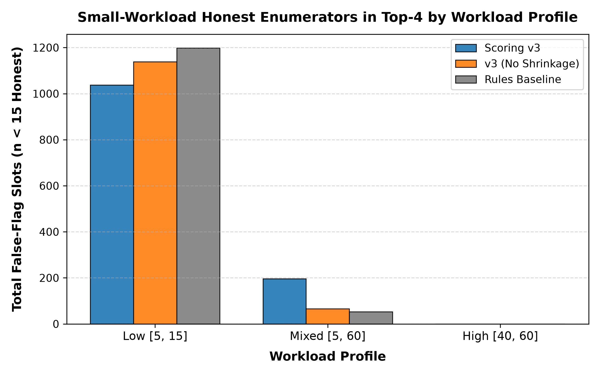
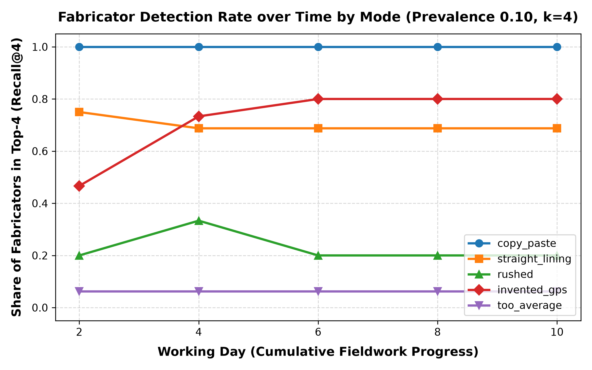

# Robustness Study Summary (Frozen Engine Scoring v3)

Full evaluation across 72 factorial configurations (1,440 rounds, seeds 1000..1019), held-out mode evaluation (seeds 2000..2019), and detection-time evaluation (seeds 3000..3019).

## 1. Precision@k by Workload Profile and Fraud Prevalence

| Workload   |   Prevalence |   Scoring v3 (Mean) | v3 10th-90th     |   No-Shrinkage (Mean) |   Rules Baseline (Mean) |
|:-----------|-------------:|--------------------:|:-----------------|----------------------:|------------------------:|
| Low        |         0.02 |              0.0979 | [0.0000, 0.2500] |                0.0979 |                  0.0625 |
| Low        |         0.05 |              0.2854 | [0.0000, 0.5000] |                0.2812 |                  0.1417 |
| Low        |         0.1  |              0.4938 | [0.2500, 0.7500] |                0.3792 |                  0.3563 |
| Low        |         0.2  |              0.7042 | [0.2500, 1.0000] |                0.5458 |                  0.6125 |
| Mixed      |         0.02 |              0.1375 | [0.0000, 0.2500] |                0.15   |                  0.0625 |
| Mixed      |         0.05 |              0.275  | [0.0000, 0.5000] |                0.2771 |                  0.1479 |
| Mixed      |         0.1  |              0.4688 | [0.2500, 0.7500] |                0.5167 |                  0.3375 |
| Mixed      |         0.2  |              0.7729 | [0.5000, 1.0000] |                0.7333 |                  0.5875 |
| High       |         0.02 |              0.1521 | [0.0000, 0.2500] |                0.15   |                  0.0479 |
| High       |         0.05 |              0.2792 | [0.0000, 0.5000] |                0.2875 |                  0.1875 |
| High       |         0.1  |              0.5229 | [0.2500, 0.7500] |                0.5729 |                  0.2812 |
| High       |         0.2  |              0.8021 | [0.5000, 1.0000] |                0.775  |                  0.5979 |

## 2. Per-Mode Recall@k (including Held-Out `partial_section`)

| Mode            | Type                           |   Evaluated Rounds |   Scoring v3 Recall@k |   No-Shrinkage Recall@k |   Rules Baseline Recall@k |
|:----------------|:-------------------------------|-------------------:|----------------------:|------------------------:|--------------------------:|
| copy_paste      | Standard Active                |                756 |                0.9702 |                  0.7897 |                    0.834  |
| straight_lining | Standard Active                |                900 |                0.4306 |                  0.5911 |                    0.07   |
| rushed          | Standard Active                |                846 |                0.3593 |                  0.3877 |                    0.6277 |
| invented_gps    | Standard Active                |                846 |                0.5585 |                  0.5177 |                    0.068  |
| too_average     | Standard Active                |                972 |                0.1147 |                  0.0571 |                    0.0432 |
| partial_section | Held-Out (Out-of-Distribution) |                 15 |                0.7333 |                  0.4667 |                    0.0667 |

## 3. Statistical Significance and Bootstrap Confidence Intervals

| Metric / Subset                           | v3 - Rules (Mean [95% CI])   | v3 - No-Shrinkage (Mean [95% CI])   |
|:------------------------------------------|:-----------------------------|:------------------------------------|
| Precision@4 (Low Workload [5, 15])        | +0.1021 [+0.0828, +0.1219]   | +0.0693 [+0.0521, +0.0865]          |
| Precision@4 (Mixed Workload [5, 60])      | +0.1297 [+0.1104, +0.1495]   | -0.0057 [-0.0214, +0.0099]          |
| Precision@4 (High Workload [40, 60])      | +0.1604 [+0.1385, +0.1823]   | -0.0073 [-0.0219, +0.0078]          |
| Precision@4 (Overall (All 72 Configs))    | +0.1307 [+0.1191, +0.1422]   | +0.0187 [+0.0094, +0.0281]          |
| Average Precision (Overall)               | +0.1946 [+0.1783, +0.2110]   | +0.0369 [+0.0257, +0.0480]          |
| Average Precision (Mode: copy_paste)      | +0.1725 [+0.1487, +0.1972]   | +0.2237 [+0.2035, +0.2440]          |
| Average Precision (Mode: straight_lining) | +0.3373 [+0.3145, +0.3603]   | -0.1152 [-0.1417, -0.0886]          |
| Average Precision (Mode: rushed)          | -0.2032 [-0.2326, -0.1734]   | -0.0498 [-0.0708, -0.0285]          |
| Average Precision (Mode: invented_gps)    | +0.4612 [+0.4312, +0.4916]   | +0.0572 [+0.0430, +0.0720]          |
| Average Precision (Mode: too_average)     | +0.1271 [+0.1097, +0.1450]   | +0.0939 [+0.0765, +0.1109]          |

## 4. Figures

- Figure 1: Small-workload honest false-flag counts: 
- Figure 2: Fabricator detection rate over time: 
