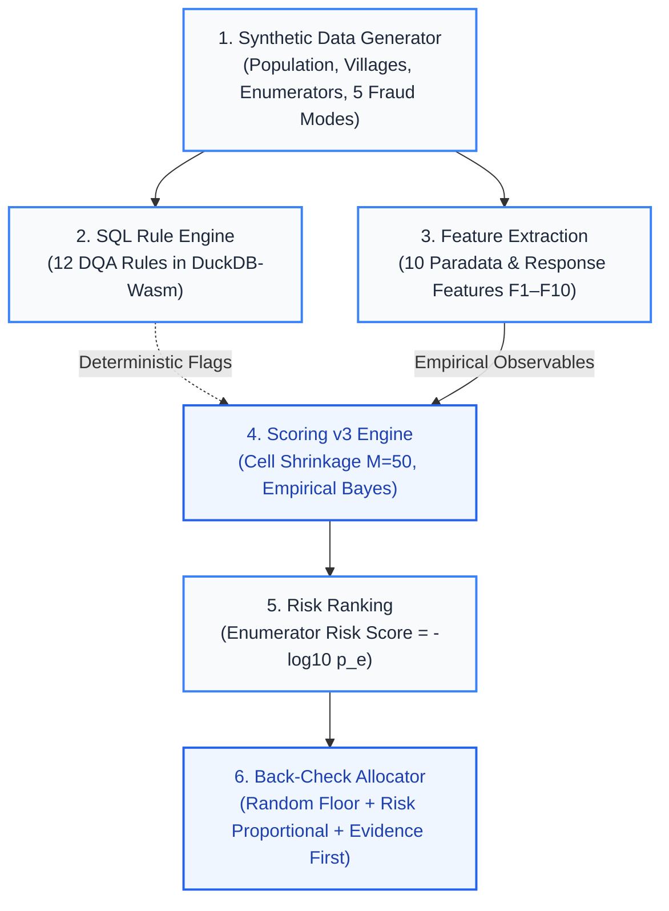

# Methodology & System Architecture

An end-to-end overview of the Curbstone Data Quality Assurance pipeline, from synthetic population generation to field back-check allocation.

---

## 1. System Lineage Architecture

The diagram below illustrates the flow of data, rules, feature estimators, and allocation policies:

---

## 2. Pipeline Components

### 1. Synthetic Data Generator
Generates realistic multi-stage cluster survey datasets mimicking household surveys in rural Bangladesh:
- **Population & Geography:** Upazilas, villages, households with intra-cluster correlation (ICC) across assets.
- **Enumerator Behavior:** Honest enumerators vary along latent speed and care traits ($s_e \sim \mathcal{N}(0, 0.20^2)$).
- **Fraud Mechanisms:** 5 standard active fabrication modes (`copy_paste`, `straight_lining`, `rushed`, `invented_gps`, `too_average`) plus 1 held-out out-of-distribution mode (`partial_section`).
- Detailed documentation: [docs/dgp.md §1–§5](https://github.com/curbstone/curbstone/blob/main/docs/dgp.md).

### 2. Live SQL Rule Engine
A fast in-browser validation engine executing 12 deterministic Data Quality Assurance (DQA) checks in DuckDB-Wasm:
- Validates interview timestamps, negative durations, rapid throughput, straight-lined asset profiles, and geographic radius bounds.
- Runs both locally in Python and in-browser via DuckDB-Wasm with exact parity.
- Rule definitions and SQL queries: [rules/rules.yaml](https://github.com/curbstone/curbstone/blob/main/rules/rules.yaml).

### 3. Feature Extraction (F1–F10)
Constructs 10 paradata and survey response metrics per enumerator:
- **F1 (Duration):** Log-duration residual vs peer enumerators in the same village.
- **F2 (Throughput):** Daily completed interview count vs survey pace.
- **F3 (Near Duplicates):** Pairwise near-duplicate household records within enumerator cells.
- **F4 (Straight-Lining):** Proportion of asset blocks with zero variance.
- **F5 & F6 (Dispersion):** Within-enumerator variance of asset counts and household sizes.
- **F7 (GPS Spread):** Spatial nearest-neighbor dispersion vs village cluster centroids.
- **F8 (Age Heaping):** Proportion of reported ages heaped on multiples of 5.
- **F9 (Non-Response):** Missingness and refusal frequency across sensitive items.
- **F10 (Duration-Size Coupling):** Correlation between interview duration and household size.
- Pre-registered hypothesis directions: [docs/dgp.md §10](https://github.com/curbstone/curbstone/blob/main/docs/dgp.md#10-scoring-plan-pre-registered).

### 4. Scoring v3 Engine (Empirical Bayes Shrinkage)
Computes shrinkage-adjusted risk scores for each enumerator:
- **Cell Shrinkage ($M = 50$):** Rare count features shrink village cell expectations toward the survey-wide mean:
  $$\hat{p}_{\text{peer}} = \frac{k_{\text{peer}} + M \cdot p_s}{n_{\text{peer}} + M}$$
- **Heterogeneity & Overdispersion:** Continuous features estimate between-enumerator variance $\tau^2$ using MAD-based estimators and test against Student-t reference distributions; count features fit beta-binomial dispersion.
- Full mathematical derivation: [docs/dgp.md §12](https://github.com/curbstone/curbstone/blob/main/docs/dgp.md#12-scoring-v3-post-hoc-final).

### 5. Risk Ranking
Orders enumerators by composite risk score:
$$\text{Risk Score} = -\log_{10} p_e$$
Where $p_e$ is the Bonferroni-corrected minimum $p$-value across valid features. Targeted back-check audits inspect the highest-ranked enumerators (Precision@$k$).

### 6. Back-Check Allocator
A two-stage stratified allocation algorithm implemented as a pure function:
1. **Random Floor:** Allocates a guaranteed fraction (e.g., 20%) of total budget uniformly across all enumerators using a seeded Mulberry32 PRNG.
2. **Risk-Weighted Allocation:** Distributes remaining budget in proportion to $\max(\text{Risk Score}, 0)$ with largest-remainder integer rounding.
3. **Evidence-First Selection:** Selects specific interviews flagged by statistical evidence (near-duplicate pairs, straight-lined submissions, clustered GPS coordinates) before choosing random interviews.
