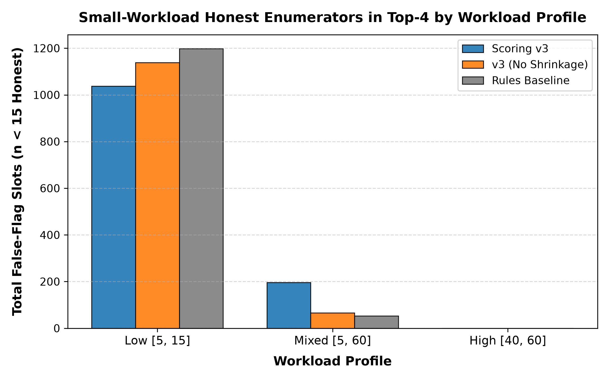
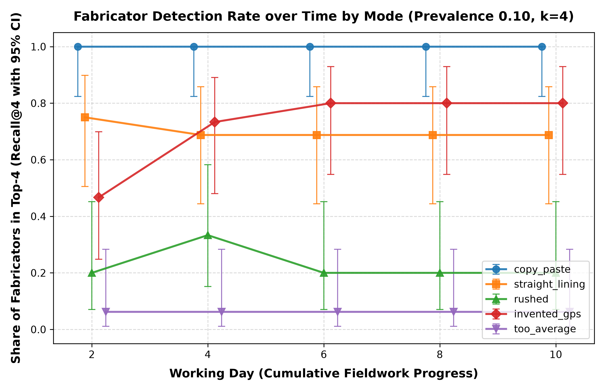

# Empirical Evaluation & Robustness Study

Performance evaluation across 72 factorial configurations (1,440 rounds, seeds 1000..1019), held-out fraud mode evaluation (seeds 2000..2019), and detection-by-day analysis (seeds 3000..3019).

```js
import { renderPrecisionChart, renderRecallChart, renderShrinkageChart } from "./components/resultsCharts.js";
```

---

## 1. Key Findings

- **Risk ranking vs deterministic rules:** +0.131 [+0.119, +0.142] precision@4 advantage (+0.195 [+0.178, +0.211] average precision).
- **Shrinkage depends on workload:** low workload +0.069 [+0.052, +0.087]; in mixed workloads it shifts false flags onto small-sample honest enumerators (196 vs 66 of 1,920 top-4 slots).
- **Rules beat ranking on rushed:** 0.63 vs 0.35 recall@4 (0.627 vs 0.347).
- **Calibrated FDR control not achieved:** uncalibrated empirical null led to frozen risk ranking approach.

Rule engine scale benchmark (1M rows): all 12 rules, median 1,712 ms over 3 runs (1,760 / 1,712 / 1,677 ms); single-threaded DuckDB-Wasm; Windows, 16 logical CPUs, Chromium 152; parity with the Python engine 12/12 rules in both scenarios.

---

## 2. Precision@k by Workload Profile and Prevalence

```js
display(renderPrecisionChart(width));
```

<details class="table-wrapper">
<summary>Full table</summary>

| Workload | Prevalence | Max Achievable | Scoring v3 (Mean) | v3 Rel. Prec. | v3 10th–90th | No-Shrink (Mean) | No-Shrink Rel. | Rules (Mean) | Rules Rel. |
| :--- | ---: | ---: | ---: | ---: | :--- | ---: | ---: | ---: | ---: |
| **Low** [5, 15] | 0.02 | 0.25 | 0.0979 | 0.3917 | [0.00, 0.25] | 0.0979 | 0.3917 | 0.0625 | 0.2500 |
| **Low** [5, 15] | 0.05 | 0.50 | 0.2854 | 0.5708 | [0.00, 0.50] | 0.2812 | 0.5625 | 0.1417 | 0.2833 |
| **Low** [5, 15] | 0.10 | 1.00 | 0.4938 | 0.4938 | [0.25, 0.75] | 0.3792 | 0.3792 | 0.3563 | 0.3563 |
| **Low** [5, 15] | 0.20 | 1.00 | 0.7042 | 0.7042 | [0.25, 1.00] | 0.5458 | 0.5458 | 0.6125 | 0.6125 |
| **Mixed** [5, 60] | 0.02 | 0.25 | 0.1375 | 0.5500 | [0.00, 0.25] | 0.1500 | 0.6000 | 0.0625 | 0.2500 |
| **Mixed** [5, 60] | 0.05 | 0.50 | 0.2750 | 0.5500 | [0.00, 0.50] | 0.2771 | 0.5542 | 0.1479 | 0.2958 |
| **Mixed** [5, 60] | 0.10 | 1.00 | 0.4688 | 0.4688 | [0.25, 0.75] | 0.5167 | 0.5167 | 0.3375 | 0.3375 |
| **Mixed** [5, 60] | 0.20 | 1.00 | 0.7729 | 0.7729 | [0.50, 1.00] | 0.7333 | 0.7333 | 0.5875 | 0.5875 |
| **High** [40, 60] | 0.02 | 0.25 | 0.1521 | 0.6083 | [0.00, 0.25] | 0.1500 | 0.6000 | 0.0479 | 0.1917 |
| **High** [40, 60] | 0.05 | 0.50 | 0.2792 | 0.5583 | [0.00, 0.50] | 0.2875 | 0.5750 | 0.1875 | 0.3750 |
| **High** [40, 60] | 0.10 | 1.00 | 0.5229 | 0.5229 | [0.25, 0.75] | 0.5729 | 0.5729 | 0.2812 | 0.2812 |
| **High** [40, 60] | 0.20 | 1.00 | 0.8021 | 0.8021 | [0.50, 1.00] | 0.7750 | 0.7750 | 0.5979 | 0.5979 |

</details>

---

## 3. Per-Mode Recall@k with Wilson 95% CIs and Counts

```js
display(renderRecallChart(width));
```

<details class="table-wrapper">
<summary>Full table</summary>

| Mode | Type | Rounds | Scoring v3 (x/n [95% CI]) | No-Shrinkage (x/n [95% CI]) | Rules Baseline (x/n [95% CI]) |
| :--- | :--- | ---: | :--- | :--- | :--- |
| **copy_paste** | Standard Active | 756 | 950/990 (0.9596) [0.9454, 0.9702] | 741/990 (0.7485) [0.7205, 0.7745] | 817/990 (0.8253) [0.8004, 0.8476] |
| **straight_lining** | Standard Active | 900 | 411/1116 (0.3683) [0.3405, 0.3970] | 630/1116 (0.5645) [0.5353, 0.5933] | 85/1116 (0.0762) [0.0620, 0.0932] |
| **rushed** | Standard Active | 846 | 343/990 (0.3465) [0.3175, 0.3766] | 359/990 (0.3626) [0.3333, 0.3931] | 621/990 (0.6273) [0.5967, 0.6568] |
| **invented_gps** | Standard Active | 846 | 561/1026 (0.5468) [0.5162, 0.5770] | 498/1026 (0.4854) [0.4549, 0.5160] | 72/1026 (0.0702) [0.0561, 0.0875] |
| **too_average** | Standard Active | 972 | 131/1278 (0.1025) [0.0870, 0.1203] | 60/1278 (0.0469) [0.0366, 0.0600] | 48/1278 (0.0376) [0.0284, 0.0494] |
| **partial_section** | Held-Out (OOD) | 15 | 11/15 (0.7333) [0.4805, 0.8910] | 7/15 (0.4667) [0.2481, 0.6988] | 1/15 (0.0667) [0.0119, 0.2982] |

</details>

**Held-Out Mode Caveat:** `partial_section` fabricates only `roster_ages` with age heaping (U[0.5, 0.8] to multiples of 5). Scoring v3 detected 11 of 15 fabricators (73.3% recall vs 6.7% for rules). Feature attribution: F8 (age heaping) appeared in 10/11 detections, and F7 (GPS dispersion) appeared in 1/11. While detection succeeded, real-world partial fabricators may fabricate non-numeric sections or adopt heaping patterns that do not align with multiples of 5.

---

## 4. Shrinkage Effect on Precision@4 by Workload

```js
display(renderShrinkageChart(width));
```

<details class="table-wrapper">
<summary>Full table</summary>

| Workload Profile | Total Slots | Scoring v3 (x/Total) | No-Shrinkage (x/Total) | Rules Baseline (x/Total) | v3 − No-Shrink (Paired 95% CI) |
| :--- | ---: | :--- | :--- | :--- | :--- |
| **Low** [5, 15] | 1920 | 1037/1920 (0.5401) | 1139/1920 (0.5932) | 1198/1920 (0.6240) | -0.0531 [-0.0708, -0.0359] |
| **Mixed** [5, 60] | 1920 | 196/1920 (0.1021) | 66/1920 (0.0344) | 53/1920 (0.0276) | +0.0677 [+0.0552, +0.0807] |
| **High** [40, 60] | 1920 | 0/1920 (0.0000) | 0/1920 (0.0000) | 0/1920 (0.0000) | +0.0000 [+0.0000, +0.0000] |
| **Overall** (72 Configs) | 5760 | 1233/5760 (0.2141) | 1205/5760 (0.2092) | 1251/5760 (0.2172) | +0.0049 [-0.0026, +0.0127] |

</details>

### Detection Rate by Working Day (Prevalence 0.10, k = 4)

<div class="table-wrapper" style="overflow-x: auto; max-width: 100%; margin: 16px 0 24px 0; background: var(--surface); border: 1px solid var(--line); border-radius: 8px;">
  <table class="results-table" style="width: 100%; border-collapse: collapse; font-size: 13px; text-align: left;">
    <thead>
      <tr style="border-bottom: 1px solid var(--line); color: var(--ink); font-weight: 600;">
        <th style="padding: 10px 12px; white-space: nowrap;">Mode</th>
        <th style="padding: 10px 12px; white-space: nowrap; text-align: right;">Day 2</th>
        <th style="padding: 10px 12px; white-space: nowrap; text-align: right;">Day 4</th>
        <th style="padding: 10px 12px; white-space: nowrap; text-align: right;">Day 6</th>
        <th style="padding: 10px 12px; white-space: nowrap; text-align: right;">Day 8</th>
        <th style="padding: 10px 12px; white-space: nowrap; text-align: right;">Day 10</th>
      </tr>
    </thead>
    <tbody>
      <tr style="border-bottom: 1px solid var(--line); color: var(--ink);">
        <td style="padding: 8px 12px; font-weight: 600; white-space: nowrap;">copy_paste</td>
        <td style="padding: 8px 12px; white-space: nowrap; text-align: right;" class="tabular-nums">18/18 [0.824, 1.000]</td>
        <td style="padding: 8px 12px; white-space: nowrap; text-align: right;" class="tabular-nums">18/18 [0.824, 1.000]</td>
        <td style="padding: 8px 12px; white-space: nowrap; text-align: right;" class="tabular-nums">18/18 [0.824, 1.000]</td>
        <td style="padding: 8px 12px; white-space: nowrap; text-align: right;" class="tabular-nums">18/18 [0.824, 1.000]</td>
        <td style="padding: 8px 12px; white-space: nowrap; text-align: right;" class="tabular-nums">18/18 [0.824, 1.000]</td>
      </tr>
      <tr style="border-bottom: 1px solid var(--line); color: var(--ink);">
        <td style="padding: 8px 12px; font-weight: 600; white-space: nowrap;">straight_lining</td>
        <td style="padding: 8px 12px; white-space: nowrap; text-align: right;" class="tabular-nums">12/16 [0.505, 0.898]</td>
        <td style="padding: 8px 12px; white-space: nowrap; text-align: right;" class="tabular-nums">11/16 [0.444, 0.858]</td>
        <td style="padding: 8px 12px; white-space: nowrap; text-align: right;" class="tabular-nums">11/16 [0.444, 0.858]</td>
        <td style="padding: 8px 12px; white-space: nowrap; text-align: right;" class="tabular-nums">11/16 [0.444, 0.858]</td>
        <td style="padding: 8px 12px; white-space: nowrap; text-align: right;" class="tabular-nums">11/16 [0.444, 0.858]</td>
      </tr>
      <tr style="border-bottom: 1px solid var(--line); color: var(--ink);">
        <td style="padding: 8px 12px; font-weight: 600; white-space: nowrap;">rushed</td>
        <td style="padding: 8px 12px; white-space: nowrap; text-align: right;" class="tabular-nums">3/15 [0.070, 0.452]</td>
        <td style="padding: 8px 12px; white-space: nowrap; text-align: right;" class="tabular-nums">5/15 [0.152, 0.583]</td>
        <td style="padding: 8px 12px; white-space: nowrap; text-align: right;" class="tabular-nums">3/15 [0.070, 0.452]</td>
        <td style="padding: 8px 12px; white-space: nowrap; text-align: right;" class="tabular-nums">3/15 [0.070, 0.452]</td>
        <td style="padding: 8px 12px; white-space: nowrap; text-align: right;" class="tabular-nums">3/15 [0.070, 0.452]</td>
      </tr>
      <tr style="border-bottom: 1px solid var(--line); color: var(--ink);">
        <td style="padding: 8px 12px; font-weight: 600; white-space: nowrap;">invented_gps</td>
        <td style="padding: 8px 12px; white-space: nowrap; text-align: right;" class="tabular-nums">7/15 [0.248, 0.699]</td>
        <td style="padding: 8px 12px; white-space: nowrap; text-align: right;" class="tabular-nums">11/15 [0.480, 0.891]</td>
        <td style="padding: 8px 12px; white-space: nowrap; text-align: right;" class="tabular-nums">12/15 [0.548, 0.930]</td>
        <td style="padding: 8px 12px; white-space: nowrap; text-align: right;" class="tabular-nums">12/15 [0.548, 0.930]</td>
        <td style="padding: 8px 12px; white-space: nowrap; text-align: right;" class="tabular-nums">12/15 [0.548, 0.930]</td>
      </tr>
      <tr style="border-bottom: 1px solid var(--line); color: var(--ink);">
        <td style="padding: 8px 12px; font-weight: 600; white-space: nowrap;">too_average</td>
        <td style="padding: 8px 12px; white-space: nowrap; text-align: right;" class="tabular-nums">1/16 [0.011, 0.283]</td>
        <td style="padding: 8px 12px; white-space: nowrap; text-align: right;" class="tabular-nums">1/16 [0.011, 0.283]</td>
        <td style="padding: 8px 12px; white-space: nowrap; text-align: right;" class="tabular-nums">1/16 [0.011, 0.283]</td>
        <td style="padding: 8px 12px; white-space: nowrap; text-align: right;" class="tabular-nums">1/16 [0.011, 0.283]</td>
        <td style="padding: 8px 12px; white-space: nowrap; text-align: right;" class="tabular-nums">1/16 [0.011, 0.283]</td>
      </tr>
    </tbody>
  </table>
</div>

---

## 5. Figures

- Figure 1: Small-workload honest false-flag counts:
  
- Figure 2: Fabricator detection rate over time (Wilson 95% CIs):
  

---

## 6. What Did Not Work

- **Benjamini–Hochberg FDR Control at q = 0.10:** Under pure honest null testing, between-enumerator heterogeneity and count dispersion generated false flags in 20 of 20 rounds.
- **Trimming and DSL Fallbacks (Amendment 1):** Winsorization and degrees-of-freedom adjustments failed to contain false-discovery inflation under severe cell-level variance.
- **Empirical-Null and Beta-Binomial Modeling (Amendment 2):** Count features still over-flagged rare events because cell peer expectations lacked shrinkage.
- **Calibrated Binary Thresholding:** Formally abandoned under the pre-specified stopping rule in favor of continuous risk ranking paired with a fixed back-check budget.

---

## 7. Known Limitations (docs/dgp.md §8 verbatim)

1. **Non-adaptive fraud.** Simulated fabricators follow fixed rules. Real fabricators learn which checks exist and avoid them, so detection rates here are likely an upper bound.
2. **Self-designed evaluation.** The same author designs the fraud and the detectors. The held-out mode (§5) reduces this risk but does not remove it.
3. **Calibration covers marginals only.** Target rates are national or rural averages. Regional variation, and correlations beyond the shared wealth factor, are not calibrated.
4. **Assumed paradata.** Duration, timing and GPS-error parameters have no public calibration source. Real paradata includes device clock errors, offline syncing and GPS dropouts that are not modelled.
5. **Secondary data sources.** The asset rates in §3.2 come from secondary reports of the BBS ICT survey and must be checked against the primary publication before release.
6. **Single primary mode per fabricator.** Real fabricators may mix strategies. Mixed-mode fraud is a planned extension.
7. **Modal knowledge in too_average.** too_average fabricators use the exact village modal values from the full frame; real fabricators know local norms only approximately, so this mode may be easier to detect than its real-world counterpart.
8. **F3 treats roster_ages as one field;** honest households with common sizes and asset profiles can match as near-duplicates.
9. **Calibrated FDR control was not achieved (Scoring v1–v3);** the delivered method is risk ranking with a fixed back-check budget.

---

## 8. Methods History

- **Scoring v1 (Pre-registered):** Planned Benjamini–Hochberg FDR control at q = 0.10. Under honest null testing (seeds 0..19), 20 of 20 rounds yielded false flags due to between-enumerator heterogeneity and count dispersion. Amendment 1 (trimming, DSL) and Amendment 2 (MAD-based tau^2, beta-binomial B = 200, empirical-null fallback) both failed honest acceptance.
- **Scoring v2 (Post-hoc Track):** Shifted primary deliverable from binary hypothesis tests to risk ranking (precision@k, recall@k for k = 10%). Evaluated on held-out seeds 100..119 (honest) and 200..219 (fraud). Fixed F3 within-cell pairing and Student-t degrees of freedom, but count features still over-flagged rare events due to un-shrunk cell peer expectations.
- **Scoring v3 (Post-hoc, Final & Frozen):** Introduced Bayesian shrinkage on cell-level peer rates toward survey-wide averages with M = 50 pseudo-trials prior to seeing evaluation outcomes. Evaluated on strictly fresh seeds 300..319 (honest) and 400..419 (fraud). Calibrated FDR control was permanently abandoned under the pre-specified stopping rule, and the engine was permanently frozen. The delivered system operates strictly as risk ranking paired with field back-check allocation.
